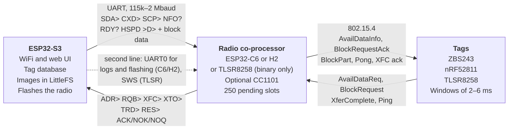

# OEPL radio chain: findings and improvement opportunities

*Draft, 2026-10-11. Nothing in this document has been decided.*

## Purpose and status

The chain ESP32-S3 → radio co-processor → tag has bugs at three levels: the serial protocol, the radio firmware and the tag firmware. This document records them, together with ideas to do better on the existing hardware.

- **Status:** everything comes from reading source code and one ESP-IDF driver file. Nothing has been built, measured or tested on hardware.
- **No decisions:** the backlog is a list of proposals; its phasing and status are tracked in [radio-chain-tasks.md](radio-chain-tasks.md).
- **Confidence** is given per finding: *confirmed in code*, *likely* or *to be verified*.
- **Constraint:** the radio protocol between AP and tag is timing-critical (windows of 2–6 ms). Every change to the AP is checked against it (see [Timing budget](#timing-budget-tag--ap)).
- **Analysed versions:** see [Sources](#sources). Line numbers refer to those commits; for `newproto.cpp`, which has moved on since, function names are given instead.

## Architecture and protocol

The S3 provides images and makes decisions; the radio co-processor runs the timing-critical radio protocol and talks to the S3 through a simple ASCII/binary protocol over UART.

How the serial protocol works today:

- **Commands** are 4 ASCII characters. Both sides shift every character through a 4-byte buffer and compare it with the known commands.
- **Payload:** a fixed-length binary struct with an 8-bit sum as the only check. No length field.
- **Replies** (`ACK>`/`NOK>`/`NOQ>`) set a single global variable on the S3, without a sequence number.
- **Block data:** `>D>` → `ACK>` → 4100 bytes XOR 0xAA → 32 padding bytes 0xF5.
- **Speed:** starts at 115200 baud. The C6 switches to 2 Mbaud after `HSPD`; the TLSR stays at 115200.

## Timing budget tag ↔ AP

The strictest window per step sets the AP's budget: a `PONG` must be on air within about 1 ms of reception. The windows come from the tag firmware; they have not been measured.

| Step | ZBS243 | nRF52811 | TLSR8258 |
| --- | --- | --- | --- |
| `PING` → `PONG` | 2 ms × 20 | 5 ms × 20 (loop is broken, see tag firmware) | 5 ms × 20 |
| `AvailDataReq` → `AvailDataInfo` | 5 ms × 14 | 5 ms × 14 | 5 ms × 14 |
| `BlockRequest` → ack | 7–9 ms × 30 | 6 ms × 10 (≈ 60 ms in total) | 50 ms × 30 |
| Behaviour during `pleaseWaitMs` | < 35: busy-wait `pw−5`, radio on; ≥ 35: sleeps `pw−25` | sleeps `pw`, radio off, then starts the radio | busy-wait `pw−10`, radio on |
| Unsafe `pleaseWaitMs` values | 1–4 (underflow) | none | 1–9 (underflow, ≈ 65 s wait) |
| Block data receive window | 315 ms, stops when the block is complete | 300 ms, radio off when the block is complete | 300 ms fixed |
| `XferComplete` → ack | 6 ms × 16 | 6 ms × 16 | 6 ms × 16 |

Derived requirements for the AP (radio firmware):

1. `PONG` within ≈ 1 ms; `AvailDataInfo` and XFC ack within ≈ 3 ms; ack to `BlockRequest` within ≈ 4 ms (airtime of the reply already subtracted).
2. Nothing blocking in the radio path: no logging, no serial handling, no `vTaskDelay`.
3. Keep the radio busy as briefly as possible: a block burst of ≈ 180 ms lets the windows of all other tags expire. nRF tags then lose their entire block request.
4. `pleaseWaitMs` is 0 or ≥ 10. Block data starts at `pw` plus a few ms of margin, because the nRF only starts its radio after `pw`.
5. Drop stale requests from the RX queue instead of answering them too late.

## Findings: serial protocol S3 ↔ radio

The protocol has no framing, no sequence numbers and no length field. One lost or extra byte throws both sides out of step, and that only recovers through timeouts and padding bytes.

| ID | Finding | Consequence | Confidence |
| --- | --- | --- | --- |
| P1 | Payloads have a fixed length without a length field; only an 8-bit sum as check | With one missed byte the receiver swallows the start of the next message | Confirmed in code |
| P2 | `ACK>`/`NOK>`/`NOQ>` set one global variable, not tied to the command | A late reply is taken as the reply to the next command | Confirmed in code |
| P3 | `espSetChannelPower` is 3 or 4 bytes, depending on `HAS_SUBGHZ` / `CONFIG_OEPL_SUBGIG_SUPPORT` | C6 (always 4) with S3 builds `ESP32_S3_C6_BIG_AP`, `ESP32-PoE-ISO_AP`, `ELECROW_ADV_2_8` (3): `SCP` never succeeds and the next command is lost. The reverse with a TLSR AP + `Nano_TLSR` build | Confirmed in code (TLSR side likely) |
| P4 | `ACK>` to `>D>` comes before the block data; there is no confirmation afterwards | The S3 never knows whether a block arrived intact | Confirmed in code |
| P5 | Block data (4100 bytes, XOR 0xAA) without framing, plus 32 padding bytes 0xF5 | Padding masks lost bytes; the block is then shifted | Confirmed in code |
| P6 | `HSPD`: the C6 sends `ACK>` twice (at 115200 and at 2 Mbaud), without confirming the new speed | A stray `ACK>` with ≈ 10 ms margin; after a C6 reset the link is dead for ± 36 s | Confirmed in code |
| P7 | Debug text (`BUSY!`, `FORCED`, `Sending parts: …`) goes over the protocol UART | Noise on the data channel | Confirmed in code |
| P8 | No version or capability handshake | Protocol changes cannot be introduced safely alongside old radios (TLSR binaries) | Confirmed in code |

## Findings: S3 firmware

The most serious S3 bug is a possible heap overflow in the parser. All points here apply regardless of the radio type.

| ID | Location | Finding | Consequence | Confidence |
| --- | --- | --- | --- | --- |
| S1 | `serialap.cpp:619` | TRD length comes from unchecked byte `packetp[9]`; `pktindex` is `uint8_t`, buffer 119 bytes | With a corrupted byte the parser writes past the buffer; with a value ≥ 246 it hangs forever | Confirmed in code |
| S2 | `serialap.cpp:629` | `strtoul` on `cmdbuffer[4]` without a terminating NUL for `VER>` | Undefined behaviour; a wrong version can trigger an unnecessary reflash | Confirmed in code |
| S3 | `rxSerialTask` | No timeout in payload states | After a lost byte the parser waits until the next message has been eaten | Confirmed in code |
| S4 | `sendBlock()` | On a failed `malloc` nothing is sent, or `c` is undefined; ± 4 KB VLA on a 6000-byte stack | C6 keeps waiting; possible stack overflow | Likely |
| S5 | `sendDataAvail()` | On `NOQ>` (queue full) still retries 5× with 200 ms pauses | Pointless delay of ± 1 s | Confirmed in code |
| S6 | `rxSerialTask2` | Recovery from a stuck modem works by parsing log text, and stops above 6000 characters/s | Under heavy load the watchdog is off exactly when it matters. With C6 firmware built with ESP-IDF 5.5.1 the case it guards against no longer occurs: the driver drops a frame into a stub buffer instead of getting stuck, and logs that only with `CONFIG_IEEE802154_DEBUG` (checked 2026-10-12); still useful for older C6 firmware | Confirmed in code |
| S7 | `waitCmdReply()` | `millis() < val + 200` | Wrong after the wrap at 49.7 days | Confirmed in code |

## Findings: C6/H2 radio firmware

The biggest brake is the polling main loop: it can lag ≈ 110 ms behind, while tags have windows of 2–6 ms. Line numbers refer to the copy in this repo (`ARM_Tag_FW/OpenEPaperLink_esp32_C6_AP`), from which releases are built. The H2 build uses the same sources.

**Bugs**

| ID | Location | Finding | Consequence | Confidence |
| --- | --- | --- | --- | --- |
| C1 | `main.c:532` | `requestedData` is overwritten before the block data has arrived; no validity flag, no check of the `blockData` checksum | Garbage to the tag (with a valid per-part checksum); with `PARTIAL_REQUEST` the block is never fetched again | Confirmed in code |
| C2 | `main.c:542` | `pleaseWaitMs = 140` assumes a fast S3; with 5 or more items in the S3 queue the first block reads a whole file from LittleFS (below that, `queueDataAvail()` already reads it into RAM in advance) | Burst starts before the block is complete | Likely |
| C3 | `main.c:364` → `:372` | With `channel == 0` the code jumps to `SCPchannelFound` and still calls `radioSetChannel(0)` | 802.15.4 on an invalid channel with auto channel + sub-GHz change | Confirmed in code |
| C4 | `main.c:670/717/732` | Cancel and XFC ack use the global `dstPan` of the previous transfer | Reply via the wrong radio (CC1101); PAN 0 after boot | Confirmed in code |
| C5 | `radio.c:122–133` | `memcpy` to `txPKT` before waiting for `isInTransmit`; the driver uses that buffer through DMA | Each frame on air carries the next frame's content: in a full block part 0 is never sent and the last part twice, so every full block needs a partial re-request | Confirmed by measurement ([results](radio-chain-results.md)) |
| C6 | `radio.c:141` | `radioSetTxPower()` is empty | The S3 always sends the fixed value 10 (there is no power setting in the web UI); the C6 keeps the driver default of 20 dBm, the maximum. Applying the 10 would cut the range, so nothing to fix (corrected 2026-10-12) | Confirmed in code |
| C7 | `radio.c:39` | `xHigherPriorityTaskWoken` not initialised | Unnecessary context switches | Confirmed in code |
| C8 | `main.c` | `RSET` does nothing (TODO); channel 27 in `channelList`; `getMillis() > blockStartTimer` fails after 49.7 days | Various edge cases | Confirmed in code |
| C9 | separate repo `AP_Radio_FW_ESP32` | Slot functions return `int8_t` with 250 slots | Memory corruption with > 128 tags; already fixed in this repo | Confirmed in code |

**Efficiency and timing**

| ID | Finding | Consequence |
| --- | --- | --- |
| E1 | One polling loop: `xQueueReceive` up to 100 ms, plus `vTaskDelay(10)` | Serial commands and `sendBlockData` up to ≈ 110 ms late; measured: block bursts start ≈ 71 ms after the promised time ([results](radio-chain-results.md)) |
| E2 | `ESP_EARLY_LOGI` in RX and TX ISR; `ESP_LOGI` for almost every command, UART0 at 115200 | ISRs lasting milliseconds; threatens the 1–3 ms window and can overflow the protocol UART |
| E3 | `radioTx` busy-waits on `isInTransmit`, without yield or timeout | CPU busy; possible hang |
| E4 | `sendBlockData` always fills up to 42 frames (≈ 180 ms) | ZBS/nRF are no longer listening; other tags miss their windows |
| E5 | RX queue (32) is fully processed after a burst | Stale replies cost airtime |
| E6 | `radioSetChannel` runs the whole `radio_init`, including 400 ms of LED blinking | 400 ms deaf |
| E7 | Double UART buffering (driver 2 KB + own 8 KB ring without overflow check); bytes sent one by one through `uart_write_bytes` | Waste; silent data loss possible |

## TLSR8258 as AP

The TLSR AP firmware is only available as a binary; its source has not been found. `ARM_Tag_FW/OpenEPaperLink_TLSR` is tag firmware, not AP firmware.

| Binary | Type | Version | Derived from strings |
| --- | --- | --- | --- |
| `OEPL_TLSR_AP.bin` | 0xF8, 802.15.4 | 0001 | Same ASCII commands; no `HSPD`, no `SCH>` |
| `OEPL_TLSR_GFSK_AP.bin` | 0xF9, Telink GFSK | 0002 | Same commands, also `RQB>`, `ADR>`, `XFC>`, `TRD>`, `XTO>` |

- **Speed:** the link stays at 115200 baud. A 4 KB block takes ≈ 360 ms, hence `pleaseWaitMs` 550.
- **Memory:** 64 KB SRAM. Caching a whole image is not possible; 2–3 block buffers of 4 KB are.
- **Flashing:** through SWS from the S3, not through a serial bootloader.
- **Open question:** does the source exist, and who has it (atc1441, OEPL maintainers)?

## Findings: tag firmware

The tags differ in windows and behaviour; the AP has to serve the strictest case. Real bugs are mainly in the edge cases of `pleaseWaitMs` and in the nRF ping loop.

| ID | Tag | Location | Finding | Consequence | Confidence |
| --- | --- | --- | --- | --- | --- |
| G1 | nRF52811 | `oepl-protocol.cpp:111–127` (Shared_Tag_CPP_Libraries) | `HAL_msDelay(10)` inside the 5 ms ping window | Tag looks only once; `PONG` only arrives through the radio buffer at the next attempt | Confirmed in code |
| G2 | nRF52811 | `performBlockRequest()` | Only 10 attempts × 6 ms for a block request | With a busy AP (burst for another tag) the whole attempt fails | Confirmed in code |
| G3 | ZBS243 | `syncedproto.c:807–808` | `timerDelay((pleaseWaitMs - 5) * …)` | Value 1–4 gives a huge wait | Confirmed in code |
| G4 | TLSR8258 | `syncedproto.c:608` | `WaitMs(pleaseWaitMs - 10)` as `uint16_t` | Value 1–9 gives a wait of ≈ 65 s | Confirmed in code |
| G5 | TLSR8258 | `blockRxLoop(300)` | Always listens 300 ms, even when the block is complete | Unnecessary radio use | Confirmed in code |
| G6 | TLSR8258 | `syncedproto.c:606–608` | Busy-wait with radio on during `pleaseWaitMs` | Higher consumption than needed | Likely |
| G7 | all | timers | Comparisons like `millis() < t` / `timerGet() < t` | Wrong around the timer wrap | To be verified per platform |

The ZBS243 repo was last updated on 4 February 2025; the nRF repo on 9 September 2026.

## Transport S3 ↔ radio

UART remains the best choice: at ≈ 23 KB/s the radio is the limiting link, and the UART at 2 Mbaud already has ≈ 9× headroom. SPI is possible on some boards, but does not solve an existing problem. Lines come from `platformio.ini`; schematics were not found.

**Lines per board**

| Boards | Lines S3 ↔ C6 |
| --- | --- |
| Nano C6, Big C6, Mini v4, Yellow, Simple, Elecrow 2.8, PoE-ISO | 6: protocol UART (TX/RX), debug UART to C6 UART0 (TX/RX), RESET → EN, PROG → GPIO9 |
| LILYGO AP, 4inch AP (`FLASHER_DEBUG_SHARED`) | 4: one shared UART (TX/RX), RESET, PROG |

**Throughput per link**

| Link | Throughput |
| --- | --- |
| 802.15.4 to the tag | ≈ 23 KB/s peak (42 × 99 B per ≈ 180 ms) |
| UART 2 Mbaud (current) | ≈ 200 KB/s |
| UART 4–5 Mbaud | 400–500 KB/s |
| SPI through the GPIO matrix | order of 1+ MB/s (slave clock limit to be verified) |

**Why not SPI.** On 6-line boards it fits exactly: three lines S3 → C6 (SCLK, MOSI, CS on GPIO9, idle high = normal boot) and two back (MISO, handshake). Still not recommended: on 4-line boards it is impossible (two transports to maintain), UART0 logging goes away, and the traces are unknown.

**What can be improved within UART**

| ID | Finding / idea | Consequence or gain |
| --- | --- | --- |
| T1 | Framing in chunks of ≤ 256 B with CRC16 and sequence number (see R2) | A control command never waits more than ≈ 1.3 ms behind bulk data; XOR 0xAA and padding bytes go away |
| T2 | `Serial1` on the S3 has the default 256 B RX buffer; `rxSerialTask` polls with `vTaskDelay(1)` below the WiFi tasks | At 2 Mbaud the buffer is full after ≈ 1.3 ms; small risk now, large with more C6 → S3 traffic |
| T3 | C6: double RX buffer (see E7); possibly UHCI DMA | Fewer copies; UART ISR does not compete with the radio ISR |
| T4 | Baud rate to 4–5 Mbaud | Only useful for bulk transfer in advance (R3), and only if the error counter (M3) allows it |
| T5 | C6 is flashed at 115200 baud | A higher baud rate in the bootloader makes a C6 OTA update much faster |
| T6 | Logs as a frame type in the main protocol | On 4-line boards, separation between data and logs; debug UART then only for flashing |

## Improvement directions

The existing hardware can clearly do better. The biggest gain is in radio firmware that never blocks and has blocks ready locally. These are directions, not decisions.

| ID | Direction | What it solves | Trade-off / risk |
| --- | --- | --- | --- |
| R1 | Event-driven C6: radio task at highest priority, serial handling in a lower task, block start via `esp_timer`, chain TX via `transmit_done` | E1, E3, C2; meets the 1–3 ms windows | Large change to the C6 code; measure first (M1) |
| R2 | Framing on the UART: COBS or SLIP with `type`, `seq`, `len`, CRC16; reply carries the `seq`; version handshake at startup | P1–P8, S1–S3 | Must stay backwards compatible with TLSR binaries (P8) |
| R3 | Cache blocks on the C6 (≈ 300 KB free): send the image at `SDA` or the first `RQB` | C1, C2; `pleaseWaitMs` to ≈ 10–15 ms, shorter awake time for ZBS/TLSR | Memory management (LRU); S3 must know the file in advance |
| R4 | Block buffer with validity flag and checksum check; use the ≈ 110 ms slack for late data, otherwise send nothing | C1 | Small, can be done separately |
| R5 | Send requested parts once plus limited repetition, instead of filling up to 42 | E4; more airtime for other tags | Repetition is needed for loss; measure packet loss first (M2) |
| R6 | Drop stale packets from the RX queue (timestamp per packet) | E5 | Thresholds per packet type to be defined |
| R7 | Logging to WARN, nothing in ISRs, faster log UART; modem watchdog in the C6 itself | E2, S6 | Less visibility while debugging; replace with a RAM trace buffer |
| R8 | TLSR AP: higher baud rate + prefetch of the next block (2–3 buffers) | 550 ms wait | Requires the source or new AP firmware based on the tag SDK |
| R9 | Tag firmware: catch `pleaseWaitMs` underflow, fix the nRF ping loop, TLSR stops early when the block is complete | G1, G3–G5 | Tags must be updated OTA; AP must keep serving old tags |

Dropped after checking against the timing budget: letting several tags download at the same time. With one half-duplex radio, a burst for tag A crowds out the windows of tag B.

## Migration to the new protocol

The S3 keeps the old protocol permanently, for old C6/H2 firmware, TLSR and the ZBS243 AP (`binaries/ZBS-AP`, version 0017). The new C6/H2 firmware speaks only the new protocol, plus the minimum of ASCII needed to be recognised at startup. This way the C6/H2 can move first, and the TLSR later.

**Supported combinations**

| S3 | Radio | Protocol |
| --- | --- | --- |
| new | old C6/H2, TLSR, ZBS AP | old, as today |
| new | new C6/H2 | new |
| old | old radio | old, unchanged |
| old | new C6/H2 | not supported: the AP stays offline until the S3 is updated |

C6/H2 firmware is not updated automatically: the user picks a release in the web UI (`handleUpdateC6` → `FlashC6_H2`). Whoever flashes a new C6 from an old S3 has to update the S3 afterwards; that works without a working radio. The H2 uses the same sources as the C6 and also reports itself as `TYP>C6`.

**Negotiation at startup**

1. The S3 always starts in the old protocol at 115200 baud: `RDY?`, then `NFO?`. Old radios therefore never see anything unknown; this matters most for the TLSR binary.
2. The new C6/H2 answers only `RDY?` and `NFO?` in ASCII, and adds an extra token to its `NFO?` reply, for example `CAP>0001` (bit mask).
3. If the S3 sees that capability, it sends `FRM1` instead of `HSPD`. After `ACK>` both sides switch to framing and a higher baud rate.
4. The first frame is a HELLO with the protocol version. No answer within ≈ 200 ms: the S3 resets the radio via RESET and tries again. Falling back to the old protocol is no longer possible with a new C6; the way out is flashing an older C6 release.
5. After a reset the radio comes back in ASCII recognition at 115200 baud. In the new mode the S3 sends a heartbeat every ≈ 1 s; after three misses it starts again at step 1. Recovery then takes a few seconds instead of ≈ 36 s.

**What it costs**

- **S3:** a transport abstraction. The functions that `newproto.cpp` calls (`sendDataAvail`, `sendCancelPending`, `sendChannelPower`, `sendBlock` and the callbacks) become the interface, with an old and a new implementation.
- **S3:** features only possible with the new protocol (block cache, logs as frames) are optional; in the old mode the S3 works as today.
- **S3:** fixes in the old path remain necessary, because TLSR and ZBS AP will use it for years: S1, S2, S3 and P3 (SCP size based on `apInfo.type`).
- **C6/H2:** no full old protocol any more; only the ASCII recognition (`RDY?`, `NFO?`, `FRM1`).
- **Test:** new S3 with old C6, new C6, TLSR and ZBS AP; old S3 with old radio.

**Order**

1. Fixes in the old path on the S3 (S1–S3, P3).
2. Transport abstraction on the S3, with only the old implementation: no change in behaviour.
3. New protocol and negotiation in the S3 and in the C6/H2 firmware, released together.
4. TLSR, as soon as there is source code or new firmware.

## Multi-AP (UDP)

Multi-AP keeps working with the new protocol, because the UDP layer sits above the transport. Only the AP where a tag is local gives pending data to its radio.

**How it works** (`udp.cpp`, `newproto.cpp`; multicast 239.10.0.1:16033)

- **Local or external:** every S3 keeps `isExternal` and `apIp` per tag. A check-in via its own radio makes the tag local; a check-in that only arrives via UDP makes it external (`processDataReq()`).
- **Content for a local tag:** `queueDataAvail(…, local = true)` gives the item to the own radio. Nothing goes over UDP.
- **Content for an external tag:** the AP only puts the item in its own S3 queue and broadcasts it as `PKT_AVAIL_DATA_REQ`. Only the AP where the tag is local fetches the image over HTTP (`/getdata`) and gives it to its radio (`prepareExternalDataAvail()`).
- **Status:** `ADR`, `XFC` and `XTO` go as UDP to the other APs, so they update their queues.
- **Channel:** an AP with channel "auto" picks its channel based on `PKT_APLIST_REQ`/`REPLY`.

**Consequences for the migration**

- The UDP messages are byte for byte the structs `espAvailDataReq`, `espXferComplete` and `pendingData`, with a type byte in front. Only `PKT_TAGINFO` has a version number (`SYNC_VERSION`). These structs therefore stay unchanged on the S3; see [Structs](#structs-keep-or-replace).
- Mixed fleets work: APs with a new C6, a TLSR or a ZBS AP exchange the same UDP messages.
- Block cache (R3): filling at `SDA` is fine, because `SDA` only goes to the radio of the AP where the tag is local. A tag that moves before fetching its data leaves an unused cache entry; LRU eviction cleans that up.
- Bug C3 (channel 0) is in the auto-channel path, which is mostly used in multi-AP setups.

## Structs: keep or replace

Advice: the over-the-air structs and those on the S3 and over UDP stay as they are. The new UART protocol does get its own message set, which the transport layer on the S3 translates to the existing structs. That way nothing changes for tags, multi-AP or the rest of the S3 code.

| Layer | Structs | Advice | Why |
| --- | --- | --- | --- |
| Air (tag ↔ radio) | `AvailDataReq`, `AvailDataInfo`, `blockRequest`, `blockRequestAck`, `blockPart`, `blockData`, `tagReturnData` | Do not touch | Fixed by tags in the field; can only be extended through `reserved` bytes and `capabilities` |
| S3 internal and UDP | `pendingData`, `espAvailDataReq`, `espXferComplete`, `espTagReturnData` | Keep | Sent byte for byte over UDP; S3s with different firmware must keep working together. A UDP protocol version number is planned (#31 in the task list), so these structs can change later towards APs that support it |
| UART, old protocol | all `esp*` structs | Keep, fixes only (P3, S1) | Still needed for TLSR, ZBS AP and old C6/H2 |
| UART, new protocol | own messages | Design new | See below |

**What is wrong with the current structs as a UART format**

| Struct | Problem | In the new UART protocol |
| --- | --- | --- |
| all `esp*` | Own 8-bit checksum per struct | Dropped; the frame has CRC16 |
| `espSetChannelPower` | Field `subghzchannel` only exists with `#ifdef HAS_SUBGHZ` (P3) | Fixed fields; "do not change" as an explicit value (e.g. 0xFF) |
| `pendingData` | Contains the `AvailDataInfo` checksum that the C6 recomputes anyway; the unit of `attemptsLeft` (minutes, via housekeeping) is documented nowhere | "Set pending" message with explicit units |
| `pendingData` for `CXD>` | 22 bytes sent while only the MAC is needed | Cancel by MAC |
| `espAvailDataReq` | No data from the AP side: RSSI, LQI, which radio (2.4 GHz or sub-GHz), PAN, time | Check-in message with those fields added; useful for diagnosis and multi-AP |
| `espBlockRequest` | Only whole 4 KB blocks, on request | Data in chunks with `dataVer`, offset and length, so the C6 can cache in advance (R3); confirmation after checksum check |
| `espTagReturnData` | Length from an unchecked field (S1) | The frame length is authoritative |

The cost is small: one translation function per message type in the new transport implementation. Once the UDP version number (#31) is in place, a UDP version 2 with the extra check-in data becomes possible; that is a separate, later decision.

## Backlog

The backlog (31 items, numbered `#1`–`#31`) is phased and tracked in [radio-chain-tasks.md](radio-chain-tasks.md). That file is the single source for priority and status.

## Measurement plan

Before behaviour changes, we measure how often the windows are missed today. The measurements M1–M4 are Phase 0 of [radio-chain-tasks.md](radio-chain-tasks.md); results are recorded there.

Test criterion for every later change: the requirements from the timing budget, measured with M1 and M2 before and after.

## Sources

| Repo | Commit | Files examined |
| --- | --- | --- |
| [OpenEPaperLink](https://github.com/OpenEPaperLink/OpenEPaperLink) | `b541ff7` (2 Oct 2026) | `ESP32_AP-Flasher/src/serialap.cpp`, `newproto.cpp`, `udp.cpp`, `ota.cpp`, `platformio.ini`; `ARM_Tag_FW/OpenEPaperLink_esp32_C6_AP/main/*`; `ARM_Tag_FW/OpenEPaperLink_TLSR/src/*`; `binaries/TLSR/*`; `oepl-esp-ap-proto.h`, `oepl-proto.h` |
| [AP_Radio_FW_ESP32](https://github.com/OpenEPaperLink/AP_Radio_FW_ESP32) | `dee391b` (23 Jan 2025) | `OpenEPaperLink_esp32_C6_AP/main/*` (outdated copy) |
| [Tag_FW_ZBS243](https://github.com/OpenEPaperLink/Tag_FW_ZBS243) | `448a247` (4 Feb 2025) | `tag_fw/syncedproto.c`, `powermgt.h` |
| [Tag_FW_nRF52811](https://github.com/OpenEPaperLink/Tag_FW_nRF52811) | `9512c05` (9 Sep 2026) | `tag_fw/src/syncedproto.cpp`, `powermgt.cpp`, `hal/Newton_M3_nRF52811/HAL_Newton_M3.cpp` |
| [Shared_Tag_CPP_Libraries](https://github.com/OpenEPaperLink/Shared_Tag_CPP_Libraries) | `e3c43bc` (15 Mar 2026) | `oepl-protocol.cpp` (protocol logic of the nRF tag) |
| [esp-idf](https://github.com/espressif/esp-idf/blob/master/components/ieee802154/driver/esp_ieee802154_dev.c) | `master` | `esp_ieee802154_dev.c`: the TX buffer goes straight to DMA |

The multi-AP and C2 findings were re-checked against `newproto.cpp` at fork commit `7fc4e36b`.

Without source: the TLSR AP firmware (`OEPL_TLSR_AP.bin`, `OEPL_TLSR_GFSK_AP.bin`).
