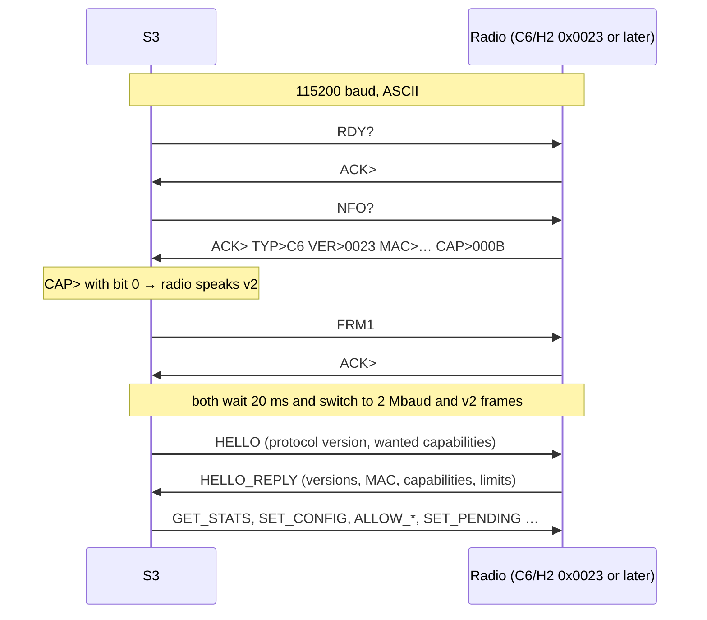

# S3 ↔ radio protocol v2

Protocol v2 is the serial protocol between the ESP32-S3 and the ESP32-C6/H2 radio co-processor: framed binary messages with COBS framing, CRC16, sequence numbers, acknowledgements and explicit fields, plus a block cache in the radio. It replaces the ASCII command protocol, which the S3 still speaks with older radios (C6/H2 up to 0022, TLSR, ZBS). The tag ↔ radio air protocol is the same. Background: problems P1–P8 and S1–S3 in [radio-chain-analysis.md](radio-chain-analysis.md); tasks in [radio-chain-tasks.md](radio-chain-tasks.md); measurements in [radio-chain-results.md](radio-chain-results.md).

Code:

- `oepl-radio-v2.h` in the repository root: message structs with size checks, constants, COBS, CRC16, frame building. Used by both sides.
- C6/H2 (`ARM_Tag_FW/OpenEPaperLink_esp32_C6_AP/main/`, also built for the H2): `v2link.c` (reception, duplicate check, event queue), `main.c` (handlers, block requests, bursts), `blockcache.c`.
- S3 (`ESP32_AP-Flasher/src/`): `v2transport.cpp` (V2Transport), `bringAPOnline()` in `serialap.cpp`, `processPreload()` and `processBlockServed()` in `newproto.cpp`.

C6/H2 firmware from 0x0023 speaks only v2: it needs an S3 build with V2Transport. 0x0022 is the last version with the ASCII protocol.

## Principles

- **Radio timing first.** The radio answers tags only from local state (pending table, block cache). Nothing in this protocol sits between a tag request and the radio's reply. On the C6/H2 the serial handling runs in the main loop, between the parts of a block burst, so the pending table and the cache need no locks and the S3 gets its answers within the timeout during a burst (a burst takes up to 200 ms).
- **Robust framing.** A lost, extra or corrupted byte costs at most one frame; the receiver is in sync again at the next delimiter.
- **Every message is confirmed or answered**, so the S3 knows what the radio has.
- **Small frames.** At most 256 payload bytes, so a control message never waits more than ≈ 1.3 ms behind bulk data at 2 Mbaud.
- **S3 internals stay the same.** V2Transport translates v2 messages to the existing structs (`espAvailDataReq`, `espBlockRequest`, `espXferComplete`, `pendingData`, `espSetChannelPower`, `espTagReturnData`); `newproto.cpp` only adds preloading and BLOCK_SERVED handling. The UDP multi-AP code is unchanged.
- All integers little-endian, structs packed, MACs in over-the-air byte order (as in the existing structs).

## Startup and negotiation



1. The S3 always starts with the ASCII protocol at 115200 baud (`RDY?`, `NFO?`), so older radios never see anything unknown.
2. A v2 radio answers only `RDY?`, `NFO?` and `FRM1` in ASCII. Its `NFO?` answer has the usual tokens plus `CAP>xxxx`, a hex capability mask (bit 0 = v2 framing). Older S3 firmware ignores the token, but cannot work with the radio.
3. On `CAP>` with bit 0 the S3 sends `FRM1` instead of `HSPD`. After `ACK>` both sides wait 20 ms (`V2_SWITCH_DELAY_MS`) and switch to 2 Mbaud and framing. There are no higher rates: some APs are hand-wired with wires of unknown length.
4. The S3 sends HELLO, up to three times with 200 ms for the reply. Without HELLO_REPLY, or with another major protocol version, it resets the radio through its RESET line and starts again at step 1; after three rounds the AP state becomes FAILED. There is no fallback to the ASCII protocol with a v2 radio.
5. The S3 sends HEARTBEAT every second (from APTask), answered with STATUS. Three missed replies in a row start `bringAPOnline()` again.
6. The radio goes back to ASCII at 115200 baud when it has received no valid frame for 5 s, so a restarted S3 finds it without a reset. After a radio reset the pending table and the cache are empty; the S3 sends everything again (`refreshAllPending()`).

## Framing

```
on the wire:  COBS( header | payload | crc16 ) 0x00
header:       type u8 | seq u8 | flags u8
crc16:        CRC-16/CCITT-FALSE (poly 0x1021, init 0xFFFF) over header and payload, little-endian
```

- **COBS** (Consistent Overhead Byte Stuffing) removes all 0x00 bytes from the frame, so 0x00 marks the end of every frame. Overhead: 1 byte per 254, plus the delimiter. A receiver that loses bytes drops the broken frame (CRC or length wrong) and is in sync again at the next 0x00.
- **Payload** at most 256 bytes; the length follows from the frame, there is no length field.
- **seq**: per direction, incremented for every new request or event (not for retransmissions). Responses carry the seq of what they answer. 8 bits, wrapping.
- **flags**: bit 0 = response (ACK, NAK, HELLO_REPLY, STATUS); bit 1 = retransmission (diagnostics only). Other bits 0.
- Frames with a wrong CRC, a payload that is too short for its type, or an unknown type are dropped and counted (STATUS counters); unknown types are answered with NAK `UNKNOWN_TYPE`, so a newer S3 can detect an older radio.

## Reliability

- Every frame that is not a response gets exactly one response: ACK, NAK, or a typed reply (HELLO_REPLY, STATUS).
- The sender keeps the frame until it is answered. No answer within 30 ms: resend with the same seq and flag bit 1, up to 3 times; then the request has failed.
- The receiver remembers the last seq it handled per direction and the response it sent. A frame with the same seq is not handled again; the stored response is sent again. This makes retries safe for SET_PENDING and DATA_CHUNK. Comparing with the last seq only is safe with stop-and-wait and a window of 4.
- Stop-and-wait per direction for control messages. DATA_CHUNK may have up to 4 chunks outstanding, acknowledged one by one; at 2 Mbaud that gives ≈ 170 KB/s, ≈ 7× the radio's on-air rate.
- Radio → S3 events are queued in the radio (24 events) and sent from its main loop; the radio never waits for the S3 before answering a tag. When the queue is full (S3 not reading), the radio drops the oldest CHECKIN or BLOCK_SERVED that is not on the line; XFER_COMPLETE, XFER_TIMEOUT, DATA_NEEDED and TAG_RETURN_DATA are kept. If there is nothing to drop, the new event is lost and logged on the radio's debug UART.

## Messages

### S3 → radio

| Type | Name | Payload | Reply |
| --- | --- | --- | --- |
| 0x01 | HELLO | `proto_major u8, proto_minor u8, wanted_caps u16` | HELLO_REPLY |
| 0x02 | HEARTBEAT | – (every second) | STATUS |
| 0x03 | SET_CONFIG | `channel u8, subghz_channel u8, tx_power_dbm i8, flags u8, led_brightness u8` — 0xFF (channels) / 0x7F (power) = do not change; flags bit 0 = log frames on, bits 1–2 = tag inventory lock (0 off, 1 locked, 2 learning); `led_brightness` 0 = activity LEDs off, 255 = full | ACK / NAK `INVALID_PARAM` |
| 0x04 | SET_PENDING | `mac[8], data_ver u64, data_size u32, data_type u8, data_type_arg u8, next_checkin u16, ttl_min u16, flags u8` — `next_checkin` as in `AvailDataInfo` (minutes, bit 15 = seconds); `ttl_min` = minutes before the radio reports XFER_TIMEOUT; flags bit 0 = data follows as DATA_CHUNKs | ACK / NAK `NO_SLOT` |
| 0x05 | CANCEL_PENDING | `mac[8]` | ACK |
| 0x06 | DATA_CHUNK | `data_ver u64, offset u32, total_size u32, bytes[≤ 240]` | ACK / NAK `NO_CACHE_SPACE` |
| 0x07 | DATA_DROP | `data_ver u64` — remove from the cache | ACK |
| 0x08 | GET_STATS | – | STATUS |
| 0x09 | ALLOW_CLEAR | – — empty the allow-list | ACK |
| 0x0A | ALLOW_ADD | `mac[8] × 1..30` | ACK / NAK `NO_SLOT` (list full; what fits is added) |
| 0x0B | ALLOW_REMOVE | `mac[8] × 1..30` | ACK |

### Radio → S3

| Type | Name | Payload | Reply |
| --- | --- | --- | --- |
| 0x81 | HELLO_REPLY | `proto_major u8, proto_minor u8, fw_version u16, hw_type u8, mac[8], caps u16, max_payload u16, cache_kb u16, pending_slots u16` | – |
| 0x82 | STATUS | `uptime_ms u32, channel u8, subghz_channel u8, tx_power_dbm i8, last_reset_reason u8, pending u16, pending_idle u16, cache_used_kb u16, rx_frames u32, tx_frames u32, late_requests_skipped u16, serial_crc_errors u16, serial_overflows u16, retransmits u16, events_queued u8` — replaces the `ZCH>`, `SCH>`, `ZPW>`, `PEN>` and `NOP>` tokens of `NFO?`; `late_requests_skipped` counts tag requests the radio found too old to answer, since the last STATUS | – |
| 0x40 | CHECKIN | `mac[8], timestamp_us u32, rssi i8, lqi u8, radio u8 (0 = 2.4 GHz, 1 = sub-GHz), channel u8, pan u16, kind u8 (0 = full, 1 = short request), answered_ver u64, answered_type u8, adr[21]` — `adr` = the tag's `AvailDataReq` as received (all zero for a short request); `answered_*` = what the radio offered | ACK |
| 0x41 | DATA_NEEDED | `mac[8], data_ver u64, offset u32, length u32, please_wait_ms u16` — the radio has no complete block for this block request; `please_wait_ms` is what it told the tag | ACK, then DATA_CHUNKs |
| 0x42 | BLOCK_SERVED | `mac[8], data_ver u64, block_id u8, parts_requested u8, frames_sent u8, late_ms i16` — one per burst; `late_ms` = burst start minus the promised time | ACK |
| 0x43 | XFER_COMPLETE | `mac[8], data_ver u64` | ACK |
| 0x44 | XFER_TIMEOUT | `mac[8], data_ver u64` | ACK |
| 0x45 | TAG_RETURN_DATA | `mac[8], timestamp_us u32, rssi i8, lqi u8, len u8, data[len]` — `data` = the tag's `tagReturnData` as received | ACK |
| 0x46 | LOG | `level u8, text[…]` (only when enabled in SET_CONFIG) | – (no reply, may be dropped) |

### Responses (both directions)

| Type | Name | Payload |
| --- | --- | --- |
| 0x7E | ACK | – |
| 0x7F | NAK | `code u8`: 1 `UNKNOWN_TYPE`, 2 `BAD_LENGTH`, 3 `INVALID_PARAM`, 4 `NO_SLOT`, 5 `NO_CACHE_SPACE`, 6 `BUSY` |

Payload sizes: HELLO_REPLY 21, STATUS 31, SET_PENDING 27, CHECKIN 49, DATA_NEEDED 26, BLOCK_SERVED 21, XFER_COMPLETE/TIMEOUT 16, DATA_CHUNK 16 + up to 240, TAG_RETURN_DATA 14 + the tag's 101 bytes.

Capability bits (`caps`, `wanted_caps`, `CAP>`): 0 v2 framing, 1 block cache, 2 sub-GHz radio present, 3 tag return data, 4 reserved (higher baud rates, not used), 5 log frames, 6 allow-list (ALLOW_* and the lock bits of SET_CONFIG, protocol 2.1). The C6/H2 announces 0, 1, 3 and 6, plus 2 when a CC1101 is present.

Not used by the current firmware: the radio does not send LOG frames (and does not announce bit 5); the S3 does not send DATA_DROP (the radio handles it); the S3 does not use the AP-side RSSI/LQI from CHECKIN yet.

## Rules

- **Pending table: one entry per tag MAC** (250 entries on the C6/H2). SET_PENDING for a MAC that already has an entry replaces it; the S3 keeps its own queue per tag and only gives the radio the item that is due. An entry with `data_type` = `DATATYPE_NOUPDATE` is an idle request: the radio offers "no update" with that `next_checkin`.
- CANCEL_PENDING removes every entry for the MAC and does not produce XFER_TIMEOUT.
- NAK `NO_SLOT`: the table is full. The S3 does not retry; the next check-in of that tag tries again.
- Once a minute the radio counts `ttl_min` down; at 0 it drops the entry and sends XFER_TIMEOUT, except for idle requests. `next_checkin` counts down with it when it is in minutes; a value in seconds (bit 15) stays as it is. The S3 fills `ttl_min` from `attemptsLeft` (at least 1).
- **XFER_COMPLETE** is sent once per transfer: a tag that repeats its XFC (because it missed the radio's ack) gets acked again on air, but not reported again. The radio drops the pending entry when it sends it.
- **CHECKIN** for every check-in the radio answered, short requests included, after the reply is on air. At 100 tags checking in every 40 s that is 2.5 frames/s of ≈ 56 bytes on the wire: negligible at 2 Mbaud.
- **SET_CONFIG**: `tx_power_dbm` carries the AP's power setting; the radio stores and reports it but does not apply it (it transmits at the driver default, task #11). The S3 maps channel 0 to "do not change", as the ASCII protocol did for sub-GHz-only use. `led_brightness` is the AP's LED setting (`config.led`): the radio drives both activity LEDs with LEDC PWM at that brightness, squared for even steps to the eye, and does not light them at 0; until the first SET_CONFIG they flash at full brightness. The S3 sends SET_CONFIG again when the LED setting changes in the web UI. The S3's own activity blink on TFT boards (`quickBlink()`) also stays off when the LED is off.
- **Tag inventory lock** ("Lock tag inventory" in the web UI, issue #177). With capability bit 6 the S3 keeps an allow-list in the radio with every MAC in its tag database: after each HELLO it sends ALLOW_CLEAR and the whole database in ALLOW_ADDs, then SET_CONFIG with the lock bits; later additions and deletions follow as ALLOW_ADD / ALLOW_REMOVE from APTask, at most 100 ms later. Until the list is complete the S3 sends lock 0. Locked, the radio does not answer a frame from a MAC that is not on the list (check-in, short request, ping, block request, XFC, tag return data) and sends no event for it, so the tag looks for another AP. Learning, it also answers a full check-in with `wakeupReason` FIRSTBOOT (0xFC); the S3 then adds the tag and puts it on the list. A ping from an unknown tag gets no PONG in either mode, so a new tag in learning mode is only picked up on the channel it boots on. A tag deleted from the database is removed from the list and is ignored from then on. The list holds 1024 MACs; when an ALLOW_ADD gets NAK `NO_SLOT` the S3 logs it and sends lock 0, so the lock then works on the S3 only, as with radios without bit 6. The radio logs once a minute on its debug UART how many frames it ignored.

## Block cache and data flow

The radio serves block requests from a cache of 4 KB blocks, keyed by `data_ver` and block number (the tag's own request unit). Caching per block instead of per file lets a radio with little RAM hold only the blocks it needs and makes eviction simple; sending a whole file is sending all its blocks.

**Size.** At startup, after all other allocations, the radio takes 4 KB blocks from the heap until 48 KB is left, at most 64 (256 KB), plus one static block, so there is always one. It reports the size as `cache_kb` in HELLO_REPLY and the use as `cache_used_kb` in STATUS.

**Data flow:**

1. **Preloading.** When the S3 sends SET_PENDING for data (not an idle request) and the item fits in the free cache (`cache_kb - cache_used_kb` from the last STATUS, minus what it queued since), it sets flag bit 0 and has `rxCmdProcessor` send all blocks as DATA_CHUNKs. The tag is usually still asleep, so this costs no tag time (about 23 ms per 4 KB block). Every check-in of a tag with queued data repeats SET_PENDING; the S3 sends a data version again only after 10 minutes, or after a new link (the radio may have been reset). The web log shows one line per preload.
2. **Check-in.** The radio answers from the pending table and sends CHECKIN.
3. **Block request**, depending on the block:
   - complete in the cache: `pleaseWaitMs` 15 ms, burst 5 ms after it (`BURST_MARGIN_MS`; the nRF52811 starts its radio only after `pleaseWaitMs`);
   - on its way for an earlier request of the same block (< 300 ms ago): 30 ms;
   - otherwise: DATA_NEEDED and 140 ms. The S3 looks the item up as `processBlockRequest()` does and sends the block as DATA_CHUNKs; the burst starts when the block is complete. If it is not complete in time, the radio sends nothing and the tag asks again. The 140 ms is not tuned.

   `pleaseWaitMs` is always 0 or ≥ 10 ms, never 1–9 (timing budget in [radio-chain-analysis.md](radio-chain-analysis.md)). In a burst the radio sends each requested part once and then repeats them until twice the number of requested parts, at most 42 frames; after the burst it sends BLOCK_SERVED. A full block request for a block that is in the cache does not force a new download: the cached data was checked per chunk by the frame CRC, and the tag checks the transfer as before.
4. **Dropping.** The radio drops the cached blocks of a data version as soon as no pending entry offers it any more (XFER_COMPLETE, XFER_TIMEOUT, CANCEL_PENDING, SET_PENDING with other data). Least-recently-used blocks are evicted when space runs out; the block a burst reads is never evicted or dropped.

DATA_CHUNKs start at the block start and are 240 bytes apart (`offset - block start` a multiple of `V2_CHUNK_MAX`); the radio tracks them in a bitmap per block. They fill the cache whether or not a pending entry with that `data_ver` exists, so the S3 can preload. A radio without a cache (`cache_kb` = 0) NAKs (`NO_CACHE_SPACE`) chunks for any block other than the one the tag asked for.

**Web UI.** Cached blocks do not pass through the S3's block request handling, so BLOCK_SERVED drives the live block x/total on the tag card and gives a log line `<MAC> block served <file> block n, parts, frames, ms late`. A log line that starts with the MAC makes the tag card flash, as the block request line does with the ASCII protocol.

Multi-AP: SET_PENDING only reaches the radio of the AP where the tag is local, so only that radio caches the data.

## Mapping to the S3 code

| v2 message | ASCII equivalent | S3 handling |
| --- | --- | --- |
| CHECKIN | `ADR>` + `espAvailDataReq` | builds `espAvailDataReq{src, adr}` → `processDataReq(…, true)` |
| DATA_NEEDED | `RQB>` + `espBlockRequest` | same lookup as `processBlockRequest()` (`getQueueItem`, `loadQueueItemData`, cancel if missing), then DATA_CHUNKs instead of `sendBlock()` |
| BLOCK_SERVED | – | `processBlockServed()`: progress on the tag card and a log line |
| XFER_COMPLETE / XFER_TIMEOUT | `XFC>` / `XTO>` + `espXferComplete` | `processXferComplete()` / `processXferTimeout()` |
| TAG_RETURN_DATA | `TRD>` + `espTagReturnData` | `processTagReturnData()`; length from the frame |
| SET_PENDING | `SDA>` + `pendingData` | from `sendDataAvail(pendingData*)`; `attemptsLeft` → `ttl_min`; preloading through `processPreload()` |
| CANCEL_PENDING | `CXD>` + `pendingData` | from `sendCancelPending()`, MAC only |
| SET_CONFIG | `SCP>` + `espSetChannelPower` | from `sendChannelPower()`; fixed fields, no `HAS_SUBGHZ` difference; lock bits from `config.lock` |
| ALLOW_CLEAR / ALLOW_ADD / ALLOW_REMOVE | – | `radioAllowListChanged()` from `addRecord()` / `deleteRecord()` (tag_db.cpp) queues the change; `syncAllowList()` from APTask sends it |
| HELLO_REPLY / STATUS | `NFO?` tokens, `RDY?` | fill `apInfo`; the heartbeat replaces the 30 s ping |

## Design choices

- **Cache per 4 KB block**, not per file: fits radios with little RAM and keeps eviction simple.
- **Repetition per burst**: each requested part at most twice, never more than 42 frames, chosen from the part loss measured in the traffic hour ([results](radio-chain-results.md)).
- **One `pleaseWaitMs` default for all tags.** The AP has to work with every tag firmware in the field, so the timing contract stays on the AP side; tag-side fixes (tasks #16, #21, #22) make tags more robust but do not replace it. A tag-specific value only if a measurement shows it saves battery.
- **2 Mbaud only**, for hand-wired APs; capability bit 4 stays reserved.
- **Sub-GHz must keep working**, but there are no sub-GHz tags here to test with. Messages carry `radio`; the CC1101 path is unchanged. Before a release, a user with sub-GHz tags should test it.
- **The radio's UART0 debug output stays**, at warning level: the ROM bootloader and crash backtraces always go there, and the S3 echoes it to its console (and, on boards with a separate debug line, checks it for the stuck-modem message). LOG frames would be for runtime logging that should reach the web UI.
- **Preloading while tags sleep** keeps serial and WiFi activity out of the tags' request windows as far as the S3 controls it; the S3's WiFi transmissions make the C6 miss tag frames now and then ([results](radio-chain-results.md#wifi-desensitisation-2026-10-13)).

## Not checked

- The cache size on a real C6 and H2: only in the radio's serial log.
- The H2 build, the 4inch AP's Uart0 build and sub-GHz: built, not tested on hardware.
