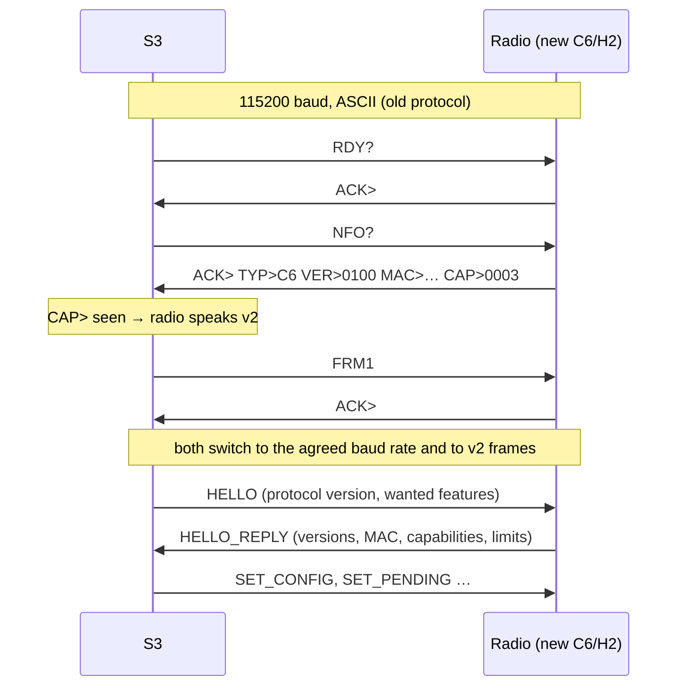

# S3 ↔ radio protocol v2 – design

*Design, 2026-10-13 (draft of 2026-10-12, checked against the phase 2 code and measurements). Task #30 in [radio-chain-tasks.md](radio-chain-tasks.md). Not implemented yet; the message structs are in [radio-protocol-v2.h](radio-protocol-v2.h), with size checks that compile for the S3 (Xtensa, C++) and the C6/H2 (RISC-V, C).*

Version 2 replaces the ASCII command protocol between the ESP32-S3 and the radio co-processor (ESP32-C6/H2 first, TLSR later) with framed binary messages: COBS framing, CRC16, sequence numbers, acknowledgements, and explicit fields. It fixes P1–P8 and S1–S3 from [radio-chain-analysis.md](radio-chain-analysis.md), carries the extra check-in data from the struct review, and adds the data chunks the block cache (R3) needs. The tag ↔ radio air protocol does not change.

## Goals and constraints

- **Radio timing first.** The radio answers tags only from local state (pending table, cache). Nothing in this protocol may sit between a tag request and the radio's reply; serial handling runs in a lower-priority task (timing budget in the analysis: `PONG` ≈ 1 ms, check-in ≈ 3 ms).
- **Robust framing.** A lost, extra or corrupted byte costs at most one frame, and the receiver resynchronises at the next delimiter. No state machine can get stuck.
- **Every message is confirmed or answered**, so the S3 knows what the radio has.
- **Small frames.** At most 256 payload bytes, so a control message never waits more than ≈ 1.3 ms behind bulk data at 2 Mbaud.
- **Migration.** The S3 keeps the old protocol for old C6/H2 firmware, TLSR and ZBS APs; a new C6/H2 only answers the ASCII recognition before switching (see Migration in the analysis). Old S3 + new C6/H2 is not supported.
- **S3 internals stay the same.** The S3's transport layer translates v2 messages to the existing structs (`espAvailDataReq`, `espBlockRequest`, `espXferComplete`, `pendingData`, `espSetChannelPower`, `espTagReturnData`), so `newproto.cpp` and the UDP multi-AP code are unchanged.
- All integers little-endian, structs packed. MACs in over-the-air byte order (as in the existing structs).

## Startup and negotiation



1. The S3 always starts with the old protocol at 115200 baud (`RDY?`, `NFO?`). Old radios never see anything unknown.
2. A v2 radio answers only `RDY?`, `NFO?` and `FRM1` in ASCII. Its `NFO?` answer contains the usual tokens plus `CAP>xxxx`: a hex bit mask (bit 0 = v2 framing; other bits as in HELLO_REPLY). Old S3s ignore the unknown token.
3. On `CAP>` with bit 0, the S3 sends `FRM1` instead of `HSPD`. After `ACK>` both sides wait 20 ms, switch to 2 Mbaud and to framing. (No higher rates: some APs are hand-wired with wires of unknown length.)
4. The S3 sends HELLO. No HELLO_REPLY within 200 ms (3 tries): the S3 resets the radio through its RESET line and starts again at step 1; after 3 failed rounds the AP state becomes FAILED. There is no fallback to the old protocol with a v2 radio.
5. After a radio reset the radio is back in ASCII recognition at 115200 baud. The S3 notices through the heartbeat (3 missed STATUS replies) and starts again at step 1. The radio's pending table and cache are empty after a reset; the S3 resends everything (as `refreshAllPending()` does today).

## Framing

```
on the wire:  COBS( header | payload | crc16 ) 0x00
header:       type u8 | seq u8 | flags u8
crc16:        CRC-16/CCITT-FALSE (poly 0x1021, init 0xFFFF) over header and payload, little-endian
```

- **COBS** (Consistent Overhead Byte Stuffing) removes all 0x00 bytes from the frame, so 0x00 marks the end of every frame. Overhead: 1 byte per 254, plus the delimiter. A receiver that loses bytes drops the broken frame (CRC or length wrong) and is in sync again at the next 0x00.
- **Payload** at most 256 bytes; the length follows from the frame, there is no length field.
- **seq**: per direction, incremented for every new request or event (not for retransmissions). Responses carry the seq of what they answer.
- **flags**: bit 0 = response (ACK, NAK, HELLO_REPLY, STATUS); bit 1 = retransmission (diagnostics only). Other bits 0.
- Frames with a wrong CRC, a payload that is too short for its type, or an unknown type are dropped and counted (STATUS counters); unknown types are answered with NAK `UNKNOWN_TYPE` so a newer S3 can detect an older radio.

## Reliability

- Every frame that is not a response gets exactly one response: ACK, NAK, or a typed reply (HELLO_REPLY, STATUS).
- The sender keeps the frame until it is answered. No answer within 30 ms: resend with the same seq, flag bit 1, up to 3 times; then the link is considered down (S3: restart negotiation; radio: keep running from local state and keep the event queued).
- The receiver remembers the last seq it handled per direction and the response it sent. A frame with the same seq is not handled again; the stored response is sent again. This makes retries safe for SET_PENDING and DATA_CHUNK.
- Stop-and-wait per direction for control messages. DATA_CHUNK may have up to 4 chunks outstanding (window), acknowledged one by one; at 2 Mbaud that gives ≈ 170 KB/s, ≈ 7× the radio's on-air rate.
- Radio → S3 events (check-ins, data needed, transfer complete) are queued in the radio and sent by its serial task; the radio never waits for the S3 before answering a tag.

## Messages

### S3 → radio

| Type | Name | Payload | Reply |
| --- | --- | --- | --- |
| 0x01 | HELLO | `proto_major u8, proto_minor u8, wanted_caps u16` | HELLO_REPLY |
| 0x02 | HEARTBEAT | – (sent every 1 s) | STATUS |
| 0x03 | SET_CONFIG | `channel u8, subghz_channel u8, tx_power_dbm i8, flags u8, led_brightness u8` — 0xFF / 0x7F = do not change (not for led_brightness); flags bit 0 = log frames on; led_brightness 0 = activity LED off, 255 = full | ACK / NAK `INVALID_PARAM` |
| 0x04 | SET_PENDING | `mac[8], data_ver u64, data_size u32, data_type u8, data_type_arg u8, next_checkin u16, ttl_min u16, flags u8` — `next_checkin` as in `AvailDataInfo` (minutes, bit 15 = seconds), `ttl_min` = minutes before the radio reports XFER_TIMEOUT (was `attemptsLeft`); flags bit 0 = data follows as DATA_CHUNK (cache) | ACK / NAK `NO_SLOT` |
| 0x05 | CANCEL_PENDING | `mac[8]` | ACK |
| 0x06 | DATA_CHUNK | `data_ver u64, offset u32, total_size u32, bytes[≤ 240]` | ACK / NAK `NO_CACHE_SPACE` |
| 0x07 | DATA_DROP | `data_ver u64` — remove from the cache | ACK |
| 0x08 | GET_STATS | – | STATUS |

### Radio → S3

| Type | Name | Payload | Reply |
| --- | --- | --- | --- |
| 0x81 | HELLO_REPLY | `proto_major u8, proto_minor u8, fw_version u16, hw_type u8, mac[8], caps u16, max_payload u16, cache_kb u16, pending_slots u16` | – |
| 0x82 | STATUS | `uptime_ms u32, channel u8, subghz_channel u8, tx_power_dbm i8, last_reset_reason u8, pending u16, pending_idle u16, cache_used_kb u16, rx_frames u32, tx_frames u32, late_requests_skipped u16, serial_crc_errors u16, serial_overflows u16, retransmits u16, events_queued u8` — the first fields replace the `ZCH>`, `SCH>`, `ZPW>`, `PEN>` and `NOP>` tokens of `NFO?`; `late_requests_skipped` counts tag requests the radio found too old to answer (phase 2, #12) since the last STATUS | – |
| 0x40 | CHECKIN | `mac[8], timestamp_us u32, rssi i8, lqi u8, radio u8 (0 = 2.4 GHz, 1 = sub-GHz), channel u8, pan u16, kind u8 (0 = full, 1 = short request), answered_ver u64, answered_type u8, adr[21]` — `adr` = the tag's `AvailDataReq` as received (all zero for a short request); `answered_*` = what the radio offered | ACK |
| 0x41 | DATA_NEEDED | `mac[8], data_ver u64, offset u32, length u32, please_wait_ms u16` — the radio has no cached data for this block request; `please_wait_ms` is what it told the tag | ACK, then DATA_CHUNKs |
| 0x42 | BLOCK_SERVED | `mac[8], data_ver u64, block_id u8, parts_requested u8, frames_sent u8, late_ms i16` — statistics, one per block request served from the cache | ACK |
| 0x43 | XFER_COMPLETE | `mac[8], data_ver u64` | ACK |
| 0x44 | XFER_TIMEOUT | `mac[8], data_ver u64` | ACK |
| 0x45 | TAG_RETURN_DATA | `mac[8], timestamp_us u32, rssi i8, lqi u8, len u8, data[len]` — `data` = the tag's `tagReturnData` as received | ACK |
| 0x46 | LOG | `level u8, text[…]` (only when enabled in SET_CONFIG) | – (no reply, may be dropped) |

### Responses (both directions)

| Type | Name | Payload |
| --- | --- | --- |
| 0x7E | ACK | – |
| 0x7F | NAK | `code u8`: 1 `UNKNOWN_TYPE`, 2 `BAD_LENGTH`, 3 `INVALID_PARAM`, 4 `NO_SLOT`, 5 `NO_CACHE_SPACE`, 6 `BUSY` |

Capability bits (`caps`, `wanted_caps`, `CAP>`): 0 v2 framing, 1 block cache, 2 sub-GHz radio present, 3 tag return data, 4 reserved, 5 log frames.

## Rules

- **Pending table: one entry per tag MAC.** SET_PENDING for a MAC that already has an entry replaces it, as `SDA>` does today; the S3 keeps its own queue per tag and only gives the radio the item that is due. An entry with `data_type` = `DATATYPE_NOUPDATE` is an idle request: the radio offers "no update" with that `next_checkin`.
- CANCEL_PENDING removes every entry for the MAC and does not produce XFER_TIMEOUT. NAK `NO_SLOT` replaces `NOQ>`; the S3 does not retry it (phase 1, #23) and tries again when the next check-in of that tag comes in.
- `ttl_min` counts down once a minute, as `attemptsLeft` does today; at 0 the radio drops the entry and sends XFER_TIMEOUT, except for idle requests.
- **XFER_COMPLETE** is sent once per transfer: a tag that repeats its XFC (because it missed the radio's ack) gets acked again on air, but not reported again. The radio drops the pending entry when it sends it.
- **CHECKIN** for every check-in the radio answered, short requests included, after the reply is on air. At 100 tags checking in every 40 s that is 2.5 frames/s of ≈ 56 bytes on the wire (49 payload, header, CRC, COBS): negligible at 2 Mbaud.
- The radio never needs the S3 to answer a tag. If the event queue is full (S3 not reading), the radio keeps answering from local state, drops the oldest CHECKIN events first and counts them; XFER_COMPLETE, XFER_TIMEOUT and TAG_RETURN_DATA are kept.
- **Sequence numbers** are 8 bits per direction and wrap; the duplicate check compares with the last handled seq only, which is safe with stop-and-wait and a window of 4.
- DATA_CHUNKs fill the cache whether or not a pending entry with that `data_ver` exists (the S3 may preload); the radio evicts least-recently-used blocks when space runs out, never a block that a burst is reading.

## Block cache and data flow

The radio serves block requests from a cache of 4 KB blocks, keyed by `data_ver` and block number (the tag's own request unit); the S3 fills it with DATA_CHUNKs. A block is ready when all its bytes have arrived. Caching per block instead of per file lets a radio with little RAM (TLSR) hold only the blocks it needs, lets the S3 send the next block while the tag receives the current one, and makes eviction simple; sending a whole file is just sending all its blocks.

1. The S3 sends SET_PENDING. With cache capability and enough space (`cache_kb` from HELLO_REPLY, `cache_used_kb` from STATUS), it sets flag bit 0 and sends the whole file as DATA_CHUNKs right away; the tag is usually still asleep, so this costs no tag time.
2. A tag checks in; the radio answers from the pending table and sends CHECKIN.
3. The tag sends a block request. If the block is cached (all bytes present and the transfer's checksum later verified by the tag as today), the radio sends ACK with `pleaseWaitMs` = 10–15 ms (never 1–9, see the timing budget) and starts the burst on time. It sends each requested part once plus a limited repetition (R5, number from M2), then BLOCK_SERVED.
4. If the block is not cached (cache full, radio reset, file too big), the radio answers the tag with a `pleaseWaitMs` long enough for the transfer (≈ 4 KB at 170 KB/s ≈ 25 ms, plus margin; 0 or ≥ 10 ms), sends DATA_NEEDED, and starts the burst only when the block is complete. If it is not complete in time it sends nothing; the tag asks again.
5. After XFER_COMPLETE or XFER_TIMEOUT the S3 sends DATA_DROP (unless another tag waits for the same `data_ver`). The radio also evicts least-recently-used entries when it needs space.

Cache size: the C6 has ≈ 300 KB free; most images are far smaller (2.9" raw 2bpp = 9.5 KB, 7.5" BWR raw ≈ 96 KB, compressed less). A TLSR radio (64 KB SRAM) would advertise 8–12 KB and rely on DATA_NEEDED.

Multi-AP is unchanged: SET_PENDING only reaches the radio of the AP where the tag is local, so only that radio caches the data.

## Mapping to the existing S3 code

| v2 message | Old equivalent | S3 handling |
| --- | --- | --- |
| CHECKIN | `ADR>` + `espAvailDataReq` | build `espAvailDataReq{src, adr}` → `processDataReq(…, true)`; keep the extra AP-side fields for the web UI and logs |
| DATA_NEEDED | `RQB>` + `espBlockRequest` | same lookup as `processBlockRequest()` (`getQueueItem`, `loadQueueItemData`, cancel if missing), then DATA_CHUNKs instead of `sendBlock()` |
| XFER_COMPLETE / XFER_TIMEOUT | `XFC>` / `XTO>` + `espXferComplete` | `processXferComplete()` / `processXferTimeout()` |
| TAG_RETURN_DATA | `TRD>` + `espTagReturnData` | `processTagReturnData()`; length from the frame |
| SET_PENDING | `SDA>` + `pendingData` | from `sendDataAvail(pendingData*)`; `attemptsLeft` → `ttl_min` |
| CANCEL_PENDING | `CXD>` + `pendingData` | from `sendCancelPending()`, MAC only |
| SET_CONFIG | `SCP>` + `espSetChannelPower` | from `sendChannelPower()`; fixed fields, no `HAS_SUBGHZ` difference |
| HELLO_REPLY / STATUS | `NFO?` tokens, `RDY?` | fill `apInfo`; STATUS replaces the 30 s ping |

## Decisions (2026-10-12)

1. **Cache per 4 KB block**, not per file (see Block cache above).
2. **Repetition per burst**: determined by measurement. After C5 is fixed (task #3), measure part loss per burst with the baseline (M2) and pick the smallest repetition that keeps re-requests rare; until then each requested part is sent once plus one repetition. *Phase 2 (2026-10-12/13): each requested part at most twice, never more than 42 frames (`939cd948`); in the traffic hour full blocks needed 154 requests for 168 bursts and 7 partial re-requests, so this stays the default.*
3. **`pleaseWaitMs`: one default for all tags**, 0 or ≥ 10 ms, with the burst starting a few ms after `pleaseWaitMs` (the nRF52811 starts its radio only after it). *Phase 2: the burst starts 5 ms after `pleaseWaitMs` (`BURST_MARGIN_MS`), measured +6.3 ms median; v2 keeps that margin.* A ZBS243-specific value only if a measurement shows it saves battery; with the cache the remaining waste is a few ms per block (≈ 0.2 mC on a ZBS243, about one check-in). The AP has to work with every tag firmware in the field, so the timing contract stays on the AP side; tag-side fixes (underflow of small values, nRF ping loop: tasks #16, #21, #22) make tags more robust but do not replace it.
4. **2 Mbaud only.** Some APs are hand-wired with wires of unknown length; capability bit 4 is reserved.
5. **Sub-GHz must keep working**, but there are no sub-GHz tags to test with. Messages carry `radio`; the CC1101 path in the radio firmware stays as it is apart from the PAN fix (C4). Before a release, ask a user with sub-GHz tags to test.
6. **The radio's UART0 debug output stays**, at warning level: the ROM bootloader and crash backtraces always go there, and the S3 echoes it to its console (and, on boards with a separate debug line, checks it for the stuck-modem message). LOG frames over v2 are for runtime logging that should reach the web UI.

## Changes to the draft (2026-10-13)

Checked against the C6 and S3 code after phase 2 and against today's measurements:

- STATUS carries the radio's channel, sub-GHz channel and TX power, and pending counts split in data and idle entries, so `NFO?` is not needed after negotiation; it also reports how many tag requests the radio skipped as too old.
- New section *Rules*: one pending entry per MAC (as the C6 does today), XFER_COMPLETE once per transfer, CHECKIN for every answered check-in, what the radio drops when the S3 does not read, sequence number wrap, preloading the cache.
- Message structs and constants in [radio-protocol-v2.h](radio-protocol-v2.h); sizes: HELLO_REPLY 21, STATUS 31, SET_PENDING 27, CHECKIN 49, DATA_NEEDED 26, BLOCK_SERVED 21, XFER_COMPLETE/TIMEOUT 16, DATA_CHUNK 16 + up to 240 bytes; TAG_RETURN_DATA 14 + the tag's 101 bytes.
- Decisions 2 and 3 got their measured values.
- Not a protocol matter, but relevant for the cache: the S3's WiFi transmissions make the C6 miss tag frames now and then ([results](radio-chain-results.md#wifi-desensitisation-2026-10-13)). Preloading blocks while tags sleep (step 1 of the data flow) keeps serial and WiFi activity out of the tags' request windows as far as the S3 controls it.
